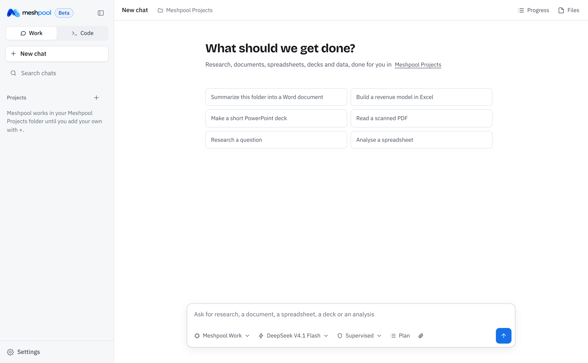
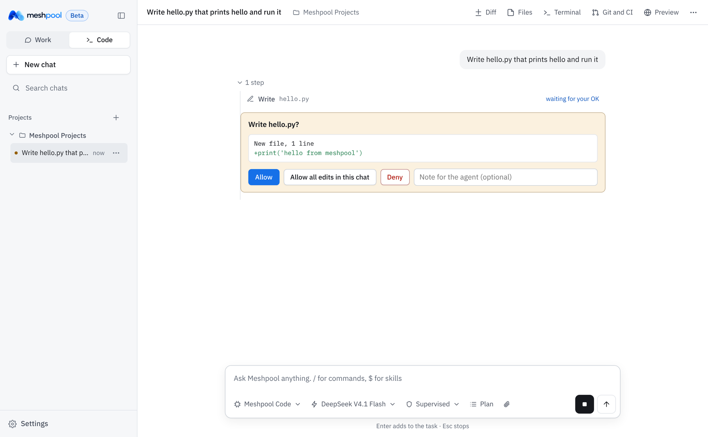
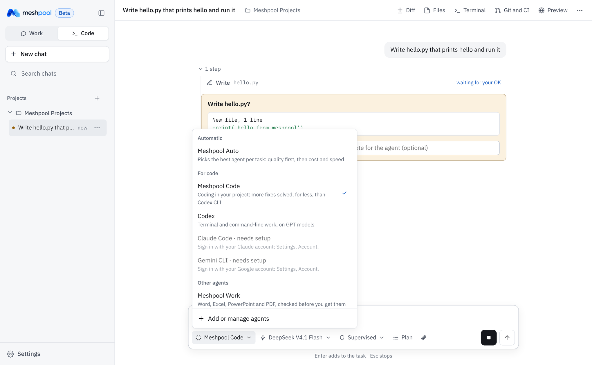

<p align="center">
  <picture>
    <source media="(prefers-color-scheme: dark)" srcset="app/meshpool_harness/ui/brand/logo-dark.png">
    
  </picture>
</p>

<p align="center"><strong>One desktop agent for code, documents, spreadsheets, decks and research, on any model.</strong></p>

<p align="center">
  <a href="https://github.com/hamzaaziada/meshpool-harness/releases"></a>
  
  
  <a href="LICENSE"></a>
</p>

Meshpool runs on your own computer. It does research, writing, analysis, spreadsheets, decks and code with any model on the Meshpool endpoint, your own API keys, or the ChatGPT, Claude and Gemini plans you already pay for.

> [!NOTE]
> **Meshpool 0.1.0 is a beta.** Some things will break. When one does, Meshpool shows what went wrong in the chat, and **Report this** (or the **Beta** badge) opens a GitHub issue with your version and system filled in. Your chats and files are never included.

## Why Meshpool

- **Every strong agent in one app.** Meshpool Code, Meshpool Work, Pi, Hermes, Codex, Claude Code and Gemini CLI, switchable per chat, with the same files, skills and connectors.
- **Meshpool Auto picks the agent for you.** For each task it takes the best measured quality for that kind of work, then the lowest cost, then the fastest. It never trades quality for price: an agent is only a cheaper choice when it scores as well (see [ROUTING.md](docs/ROUTING.md)).
- **Any model on one key.** One Meshpool key reaches every model on the Meshpool endpoint. OpenAI-compatible endpoints, Anthropic and Gemini keys, and ChatGPT, Claude and Google sign-ins work too.
- **Office files that open clean.** Real Word, Excel (with live formulas) and PowerPoint. Every deck is checked against 20 design rules, every workbook against 13, and every file against the Office file schemas before it reaches you.
- **Your tools come with you.** 58 connectors plus any remote MCP server, about 100 skills, and the skills and MCP servers you already set up in Claude, Codex, Cursor, VS Code and others.
- **Local by design.** Your files stay on your computer, and connector sign-ins go straight from your computer to the app, with no Meshpool server in between.

<p align="center">
  <picture>
    <source media="(prefers-color-scheme: dark)" srcset="docs/screenshots/home-dark.png">
    
  </picture>
</p>

| You stay in control | Pick the agent, or let Auto pick |
|---|---|
|  |  |
| Every change shows up as a diff you approve, or you let it run. Undo reverses any reply. | Each agent says what it does best. Meshpool Auto picks per task from the benchmarks. |

### Measured, not claimed

Each agent ran on the same model (DeepSeek V4.1 Flash), on the same tasks with the same graders, at the same time. The full tables are in [docs/BENCHMARKS.md](docs/BENCHMARKS.md).

| Agent | Best at | Result |
|---|---|---|
| **Meshpool Code** | Coding in your project | SWE-bench Verified: 18 of 20 solved at $0.0079 per solved task. Codex CLI solved 17 at $0.0101. |
| **Meshpool Work** | Word, Excel, PowerPoint and PDF work | Practical office run: all 7 tasks passed (proposal, live-formula workbook, chart deck, contract edit in place, invoices to Excel, PDF, letters). The Word proposal took 42 s; Hermes took 64 s. |
| **Meshpool's agent loop, browser use** | Web forms and web apps | MiniWoB++: 97 of 102 at $0.0027 and 17 s per solved task. Claude Code also solved 97, at $0.0082 and 21 s. |

## Download

| Computer | Download |
|---|---|
| Mac with Apple silicon (M1 or later) | [Meshpool.dmg](https://github.com/hamzaaziada/meshpool-harness/releases/latest/download/Meshpool.dmg) |
| Mac with an Intel processor | [Meshpool-Intel.dmg](https://github.com/hamzaaziada/meshpool-harness/releases/latest/download/Meshpool-Intel.dmg) |
| Windows 10 or 11 (64-bit) | [Meshpool-Setup.exe](https://github.com/hamzaaziada/meshpool-harness/releases/latest/download/Meshpool-Setup.exe) |

All versions and checksums are on the [Releases](https://github.com/hamzaaziada/meshpool-harness/releases) page.

### Install

- **Mac:** open the dmg and drag Meshpool to Applications. The app is not notarized yet, so the first time, right-click Meshpool in Applications and choose **Open**.
- **Windows:** run Meshpool-Setup.exe. If SmartScreen appears, choose **More info**, then **Run anyway**.

On first launch, paste your Meshpool API key. Then choose where Meshpool can work, and allow the permissions it asks for.

## Quick start

There are three ways to run Meshpool.

1. **Desktop app:** download it above.
2. **Command line.** One command installs it and walks you through setup in the terminal. On macOS or Linux:

   ```sh
   curl -fsSL https://raw.githubusercontent.com/hamzaaziada/meshpool-harness/main/install.sh | sh
   ```

   On Windows, in PowerShell:

   ```powershell
   irm https://raw.githubusercontent.com/hamzaaziada/meshpool-harness/main/install.ps1 | iex
   ```

   Setup asks what Meshpool runs on (your Meshpool API key, another provider's key, your ChatGPT subscription, or your Claude subscription for Claude Code), where it works and what it may do without asking. Then the session starts. Later, type `meshpool` in any project folder; `meshpool setup` changes your choices. If your computer has no Python 3.10 or later, the installer downloads a private copy.

3. **In your browser on localhost:** after installing the command line, run `meshpool ui`. It opens the full app at `http://127.0.0.1:8765`. It runs only on your computer and is not reachable from other machines.

### Choose the agent and where its models run

The message box has two choices. The **agent** pill picks who does the work (Meshpool Code, Meshpool Work, Pi, Hermes, Codex, Claude Code, Gemini CLI, or Meshpool Auto). The **model** pill picks where inference runs: a tab per provider, then the model. See [docs/PROVIDERS.md](docs/PROVIDERS.md).

- **Meshpool**, or any OpenAI-compatible endpoint, with your API key.
- **ChatGPT:** your ChatGPT Plus, Pro or Business plan, for Meshpool's agents, Pi, Hermes and Codex. No API key needed.
- **Claude:** an Anthropic API key for any agent, or your Claude Pro or Max plan in Claude Code.
- **Gemini:** a Gemini API key for any agent, or your Google sign-in in Gemini CLI.

Claude and Google sign-ins run only in Claude Code and Gemini CLI, because Anthropic's and Google's terms don't let other apps use them. Connect providers at sign-up or in **Settings**, **Account and key**, **Providers**. Signing in needs Node.js, which the desktop app includes.

### Bring your skills and MCP servers

On first launch, and later under **Settings**, Meshpool finds the skills and MCP servers you already use, and imports the ones you pick. It looks in:

- Claude Desktop and Claude Code;
- Codex;
- Cursor, Windsurf, VS Code, Cline and Gemini CLI.

## What it does

- **Two modes.**
  - **Cowork** is a chat with a live progress panel and the files the task made.
  - **Code** adds diff, terminal, Git, pull request, CI and deployment panels.
- **Harnesses (the agent behind a thread), switchable per thread:**
  - **Meshpool Auto** picks the agent for each task from benchmark results: quality first, then cost, then speed. See [docs/ROUTING.md](docs/ROUTING.md).
  - **Meshpool Code, Meshpool Work, Pi and Hermes** run on your Meshpool key, another API key, an Anthropic or Gemini key, or your ChatGPT sign-in.
  - **Codex** runs on your Meshpool key, another API key, or your ChatGPT sign-in.
  - **Claude Code** runs on your Claude sign-in or an Anthropic API key.
  - **Gemini CLI** runs on your Google sign-in or a Gemini API key.
- **Web research without a browser.**
  - The agent can search the web and read pages, PDFs and Office files.
  - It can research a question across many sources at once, with links you can check.
- **Connectors:** 58 apps, each checked against its live server. Sign-in runs directly between your computer and the app; Meshpool runs no server in between.
  - **Engineering:** GitHub, GitLab, Linear, Jira and Confluence, Sentry, Vercel, Netlify, Cloudflare, Supabase, Neon, Prisma, PostHog, Jam, Hugging Face, Context7 and DeepWiki.
  - **Work and documents:** Gmail, Google Calendar, Google Drive, Slack, Notion, Asana, ClickUp, monday.com, Airtable, Dropbox, Box, Miro, Granola, Fireflies, Otter, tl;dv, Docusign, Zapier, Make and Pipedream.
  - **Sales and marketing:** HubSpot, Attio, Close, Apollo, Lusha, Instantly, Intercom, Mailchimp, Semrush, Similarweb, Wix, Webflow, Canva and Gamma.
  - **Finance and data:** Stripe, PayPal, Square, Crunchbase, Morningstar, Exa and Firecrawl.
  - **Any other remote MCP server** by its address. Meshpool works out whether it needs nothing, a token or a browser sign-in.
  - Apps that only sign in apps they know (Google, Slack, HubSpot and a few others) take a client ID you create in that app.
  - In the terminal: `meshpool connect`, `meshpool connect notion` or `meshpool connect https://...`, and `/connect` inside a session.
- **Skills**, shared by every agent: about 100 built in, for email and meetings, writing, marketing, product, hiring, data, projects, engineering, sales, finance and legal. Add your own, or import them from Claude, Codex and Cursor.
- **Instructions and memory** that carry over between chats.
- **Scheduled tasks**, such as a daily brief or a weekly report.
- **Parallel sub-agents** for big jobs.
- **Files in:** PDF (including scans, with offline OCR in many languages), Word, Excel, PowerPoint, Power BI, CSV, images and more.
- **Files out:** Excel, PowerPoint, Word and PDF.
- **Control while it works:**
  - **Enter** adds to the task.
  - **Interrupt** stops the task and does your new message instead.
  - **Esc** stops.

## Repository layout

| Folder | Contents |
|---|---|
| `app/` | Meshpool's source: the agent, the desktop app UI, the office engines, defaults and tests. |
| `packaging/` | Build scripts, the Mac and Windows launchers, the Windows installer script, icons and the Hermes patch. |
| `testkit/` | A mock model server, end-to-end and UI tests, and the real-model checks. See [JOURNEYS.md](testkit/JOURNEYS.md). |
| `docs/` | [Benchmarks](docs/BENCHMARKS.md), [building](docs/BUILDING.md), [releasing](docs/RELEASING.md), [routing](docs/ROUTING.md); developer notes in `docs/dev/`. |
| `harness-lab/` | Harness experiments: the [log](harness-lab/LOG.md), findings, benchmark drivers and summary results, and working notes. |

To run from source during development:

```sh
cd app
pip install -r requirements.txt
python -m meshpool_harness ui
```

## License and credit

Meshpool is licensed under the [Apache License 2.0](LICENSE). You can use, change and share it.

If you redistribute Meshpool or anything based on it, you must keep the [NOTICE](NOTICE) file and its credit to Meshpool. The Meshpool name and logo are not licensed: a modified version must use its own name and logo.

Meshpool bundles third-party open-source software, each under its own license. See [THIRD_PARTY_NOTICES.md](THIRD_PARTY_NOTICES.md).
