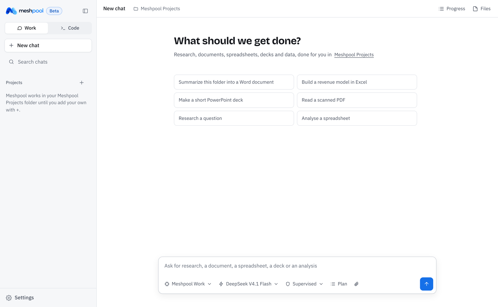
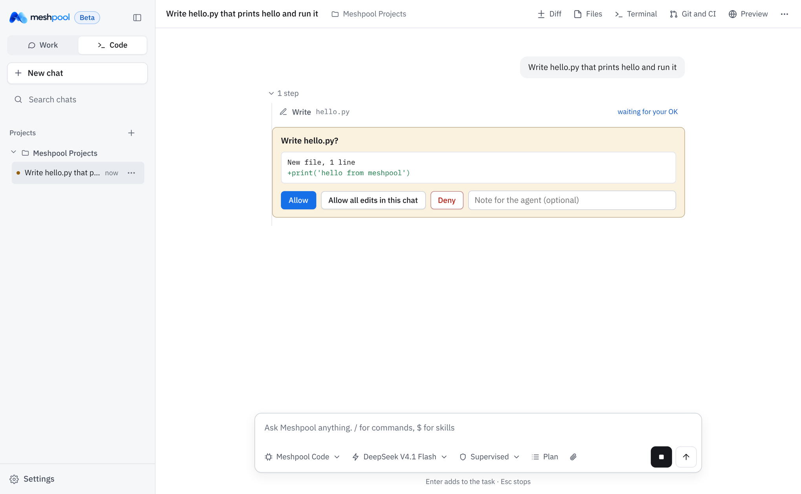
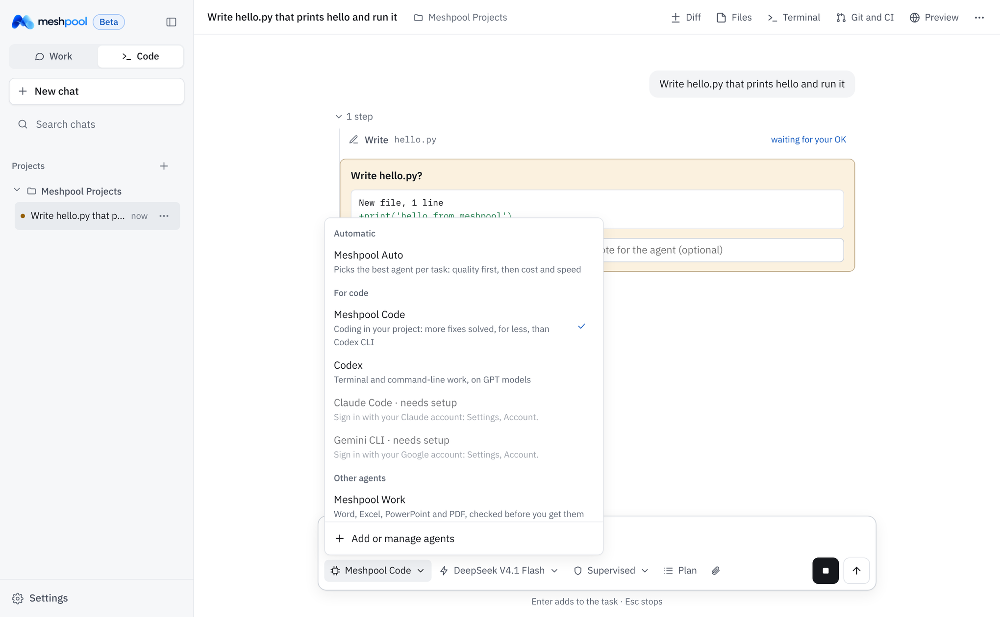

<p align="center">
  <picture>
    <source media="(prefers-color-scheme: dark)" srcset="app/meshpool_harness/ui/brand/logo-dark.png">
    
  </picture>
</p>

<p align="center"><strong>One desktop agent for code, documents, spreadsheets, decks and research, on any model.</strong></p>

<p align="center">
  <a href="https://github.com/hamzaaziada/meshpool-harness/releases"></a>
  
  
</p>

Meshpool runs on your own computer. It does research, writing, analysis, spreadsheets, decks and code with any model on the Meshpool endpoint, your own OpenAI-compatible key, or the ChatGPT plan you already pay for.

> [!NOTE]
> **Meshpool 0.0.1 is a beta.** Some things will break. When one does, Meshpool shows what went wrong in the chat, and **Report this** (or the **Beta** badge) opens a GitHub issue with your version and system filled in. Your chats and files are never included.

## Why Meshpool

- **Every strong agent in one app.** Meshpool Code, Meshpool Work, Pi, Hermes, Codex and OpenCode, switchable per chat, with the same files, skills and connectors. Add any other agent that speaks the Agent Client Protocol in Settings.
- **Meshpool Auto picks the agent for you.** For each task it takes the best measured quality for that kind of work, then the lowest cost, then the fastest. It never trades quality for price: an agent is only a cheaper choice when it scores as well (see [ROUTING.md](docs/ROUTING.md)).
- **Any model on one key.** One Meshpool key reaches every model on the Meshpool endpoint. Any OpenAI-compatible endpoint works too, and so does signing in with your ChatGPT plan.
- **Office files that open clean.** Real Word, Excel (with live formulas) and PowerPoint. Every deck is checked against 20 design rules, every workbook against 13, and every file against the Office file schemas before it reaches you.
- **Local by design.** Your files stay on your computer, and connector sign-ins go straight from your computer to the app, with no Meshpool server in between.

<p align="center">
  <picture>
    <source media="(prefers-color-scheme: dark)" srcset="docs/screenshots/home-dark.png">
    
  </picture>
</p>

| You stay in control | Pick the agent, or let Auto pick |
|---|---|
|  |  |
| Every change shows up as a diff you approve, or you let it run. Undo reverses any reply. | Each agent says what it does best. Meshpool Auto picks per task from the benchmarks. |

### Measured, not claimed

Each agent ran on the same model (DeepSeek V4.1 Flash), on the same tasks with the same graders, at the same time. The full tables are in [docs/BENCHMARKS.md](docs/BENCHMARKS.md).

| Agent | Best at | Result |
|---|---|---|
| **Meshpool Code** | Coding in your project | SWE-bench Verified: 18 of 20 solved at $0.0079 per solved task. Codex CLI solved 17 at $0.0101. |
| **Meshpool Work** | Word, Excel, PowerPoint and PDF work | Practical office run: all 7 tasks passed (proposal, live-formula workbook, chart deck, contract edit in place, invoices to Excel, PDF, letters). The Word proposal took 42 s; Hermes took 64 s. |
| **Meshpool's agent loop, browser use** | Web forms and web apps | MiniWoB++: 97 of 102 at $0.0027 and 17 s per solved task. In a same-time round, $0.0009 per solved task against $0.0025 for Codex CLI. |

## Install

| Computer | Download |
|---|---|
| Mac with Apple silicon | [Meshpool.dmg](https://github.com/hamzaaziada/meshpool-harness/releases/latest/download/Meshpool.dmg) |
| Mac with Intel | [Meshpool-Intel.dmg](https://github.com/hamzaaziada/meshpool-harness/releases/latest/download/Meshpool-Intel.dmg) |
| Windows 10 or 11 | [Meshpool-Setup.exe](https://github.com/hamzaaziada/meshpool-harness/releases/latest/download/Meshpool-Setup.exe) |

**Setup guide** ([full guide](https://github.com/hamzaaziada/meshpool-harness/blob/main/docs/SETUP.md))

*Mac, quickest:* open Terminal, paste this and press Return. It installs Meshpool and opens it with no security prompts:

```sh
curl -fsSL https://raw.githubusercontent.com/hamzaaziada/meshpool-harness/main/install.sh | bash -s -- --app
```

*Mac, from the download:*
1. Not sure which Mac you have? Apple menu → About This Mac: **Chip: Apple M…** takes Meshpool.dmg, **Intel** takes Meshpool-Intel.dmg.
2. Open the .dmg and drag **Meshpool** onto **Applications**.
3. Double-click Meshpool in Applications. macOS blocks it the first time: click **Done**.
4. Open **System Settings → Privacy & Security**, scroll to **Security**, click **Open Anyway** and enter your password. Meshpool opens, and opens normally from then on. (macOS 14 and earlier: right-click Meshpool in Applications, choose **Open**, then **Open**.)

*Windows:* run Meshpool-Setup.exe. If "Windows protected your PC" appears, click **More info**, then **Run anyway**.

*First launch:* paste your Meshpool API key ([get one at meshpool.ai](https://meshpool.ai)) or sign in with ChatGPT, then choose the folder Meshpool may work in. Updates: click the "is available" bar, or Settings → About → **Check for updates**, then **Update now**.

Apple silicon Macs need macOS 11 or later; Intel Macs macOS 10.15 Catalina or later (on 10.15, Pi, Codex, OpenCode and browser use need macOS 11). Meshpool is not yet signed by Apple or Microsoft, which is why your computer asks you to confirm it once.


**Command line** (macOS, Linux, Windows). One command installs it and runs setup; then type `meshpool` in any project folder, or `meshpool ui` for the full app in your browser.

```sh
curl -fsSL https://raw.githubusercontent.com/hamzaaziada/meshpool-harness/main/install.sh | sh
```

```powershell
irm https://raw.githubusercontent.com/hamzaaziada/meshpool-harness/main/install.ps1 | iex
```

## What it does

- **Work and Code modes.** Work is a chat with a live progress panel and the files the task made. Code adds diff, terminal, Git, pull request and CI panels.
- **Agents:** Meshpool Auto, Meshpool Code, Meshpool Work, Pi, Hermes, Codex and OpenCode, or your own, on your Meshpool key, any OpenAI-compatible key, or your ChatGPT plan ([providers](docs/PROVIDERS.md)).
- **Files in and out:** PDF (scans included, with offline OCR), Word, Excel, PowerPoint, Power BI, CSV and images in; Word, Excel, PowerPoint and PDF out.
- **Web research** across many sources, with links you can check.
- **58 connectors** (GitHub, Linear, Jira, Slack, Notion, Google Drive, HubSpot, Stripe and more) plus any remote MCP server. Sign-in goes straight from your computer to the app.
- **About 100 skills**, and the skills and MCP servers you already use in Claude Desktop, Codex, Cursor, VS Code and others, imported in a click.
- **Memory, scheduled tasks and parallel sub-agents.**
- **You stay in control:** Enter adds to the task, Interrupt redirects it, Esc stops, and Undo reverses any reply.

## For developers

```sh
cd app
pip install -r requirements.txt
python -m meshpool_harness ui
```

`app/` holds the agent, the desktop UI, the office engines and the tests; `packaging/` the installers and launchers; `testkit/` the mock model and end-to-end checks; `docs/` [benchmarks](docs/BENCHMARKS.md), [routing](docs/ROUTING.md), [building](docs/BUILDING.md) and [releasing](docs/RELEASING.md).

## Credits

Meshpool bundles third-party open-source software, each under its own license: see [THIRD_PARTY_NOTICES.md](THIRD_PARTY_NOTICES.md). The Meshpool name and logo belong to Meshpool.
