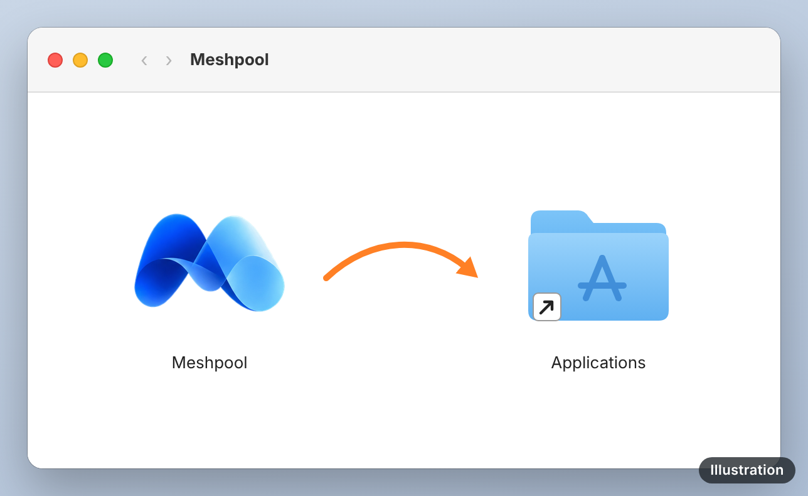
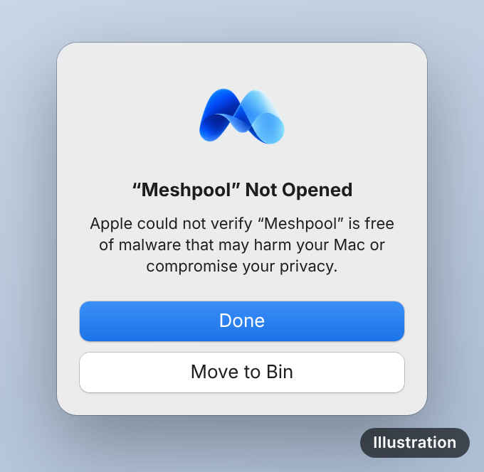
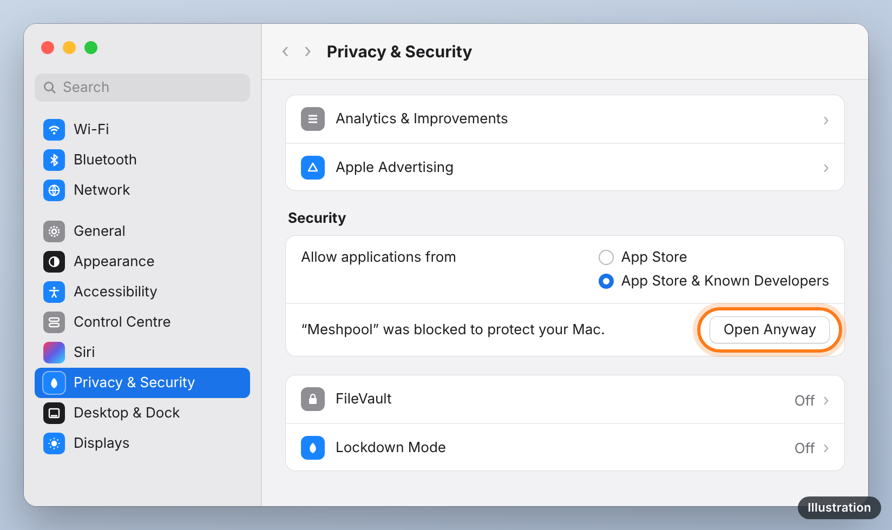
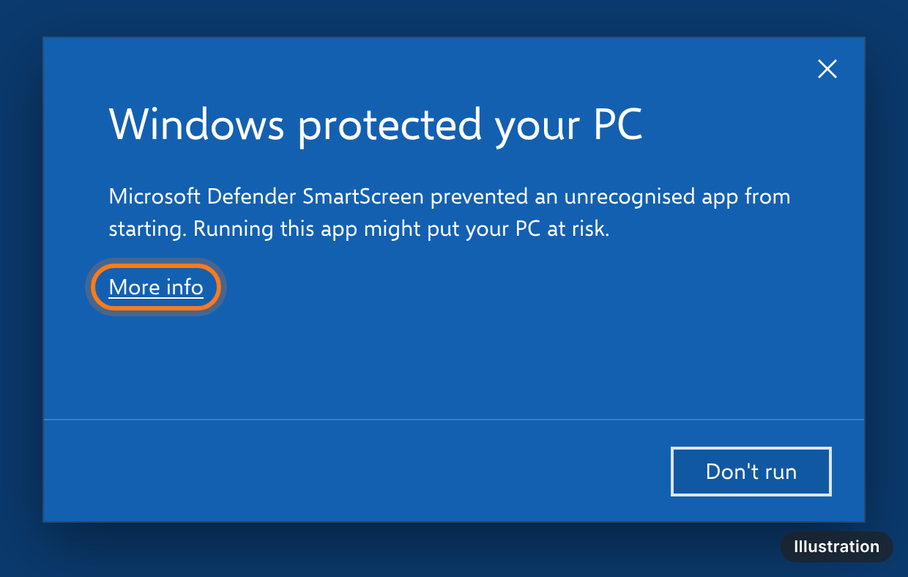
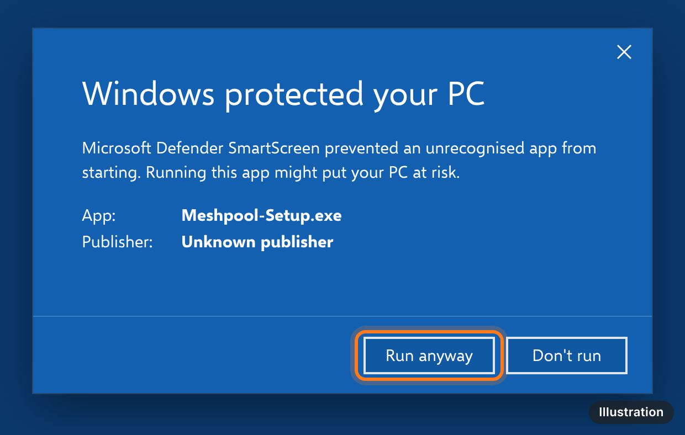
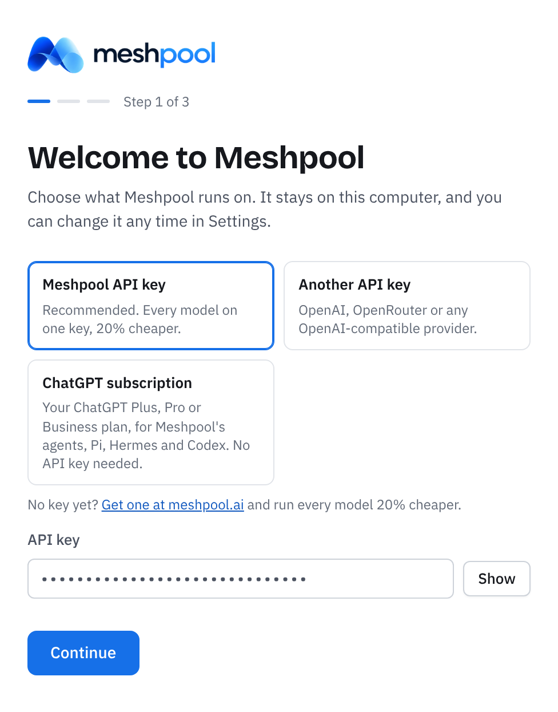
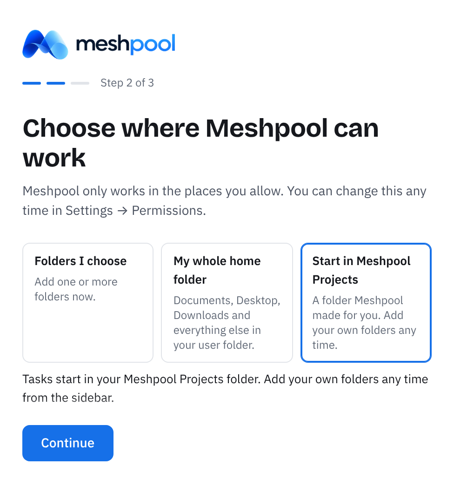
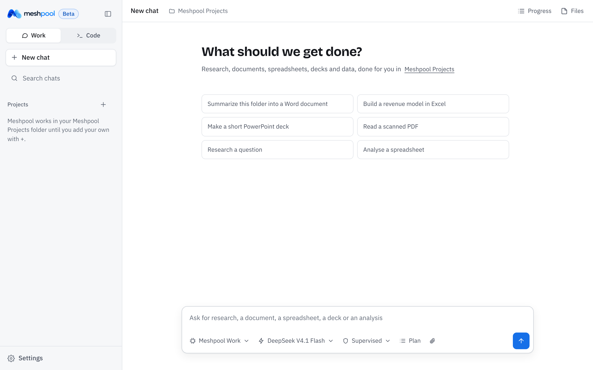
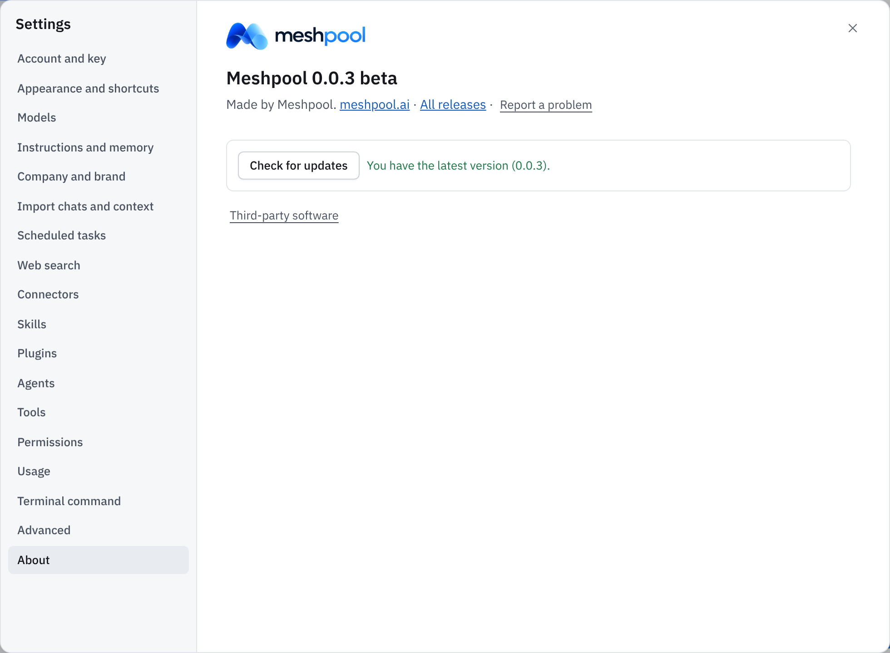

# Set up Meshpool

About five minutes. Meshpool is in beta and is not yet signed by Apple or Microsoft, so your computer asks you to confirm it once. Each step below says what you will see.

## 1. Pick the right download

| Your computer | How to tell | Download |
|---|---|---|
| Mac with Apple silicon (M1, M2, M3, M4) | Apple menu → About This Mac shows **Chip: Apple M…** | [Meshpool.dmg](https://github.com/hamzaaziada/meshpool-harness/releases/latest/download/Meshpool.dmg) |
| Mac with Intel | About This Mac shows **Processor: … Intel** | [Meshpool-Intel.dmg](https://github.com/hamzaaziada/meshpool-harness/releases/latest/download/Meshpool-Intel.dmg) |
| Windows 10 or 11 | | [Meshpool-Setup.exe](https://github.com/hamzaaziada/meshpool-harness/releases/latest/download/Meshpool-Setup.exe) |

Macs with Apple silicon need macOS 11 Big Sur or later. Intel Macs need macOS 10.15 Catalina or later (on 10.15, Pi, Codex, OpenCode and browser use need macOS 11).

## 2. Install on a Mac

**The quickest way: one command, no security prompts.** Open Terminal (press Cmd+Space, type Terminal, press Return), paste this line and press Return:

```sh
curl -fsSL https://raw.githubusercontent.com/hamzaaziada/meshpool-harness/main/install.sh | bash -s -- --app
```

It downloads Meshpool into Applications and opens it. Skip to step 4.

**Or from the download:**

1. Open **Meshpool.dmg** (or Meshpool-Intel.dmg) from your Downloads folder.
2. Drag **Meshpool** onto the **Applications** folder in the window that opens.

   
3. Open your Applications folder and double-click **Meshpool**. macOS says it cannot verify that Meshpool is free of malware and does not open it. Click **Done**. (Do not click Move to Bin.)

   
4. Open **System Settings → Privacy & Security** and scroll down to **Security**. You will see "Meshpool was blocked to protect your Mac". Click **Open Anyway**, enter your Mac password, then click **Open Anyway** once more.

   

Meshpool now opens, and opens normally from then on.

On macOS 14 Sonoma and earlier there is a shorter way for step 4: in Applications, right-click (or Control-click) **Meshpool**, choose **Open**, then **Open**.

## 3. Install on Windows

1. Run **Meshpool-Setup.exe** from your Downloads folder.
2. If Windows shows "Windows protected your PC", click **More info**, then **Run anyway**.

   

   
3. Follow the installer. Meshpool opens when it finishes, and is in the Start menu from then on.

Or with one command in PowerShell (Start → type PowerShell → Enter):

```powershell
& ([scriptblock]::Create((irm https://raw.githubusercontent.com/hamzaaziada/meshpool-harness/main/install.ps1))) -App
```

Pictures of the macOS and Windows prompts are illustrations; the wording on your computer may differ slightly.

## 4. First launch

1. **Choose how Meshpool runs its models.** Paste a Meshpool API key (get one at [meshpool.ai](https://meshpool.ai)), use another OpenAI-compatible key, or sign in with your ChatGPT plan. Meshpool checks the key before it saves it.

   
2. **Choose a folder** for Meshpool to work in. It reads and writes only there unless you allow more, and files it makes go into a **Meshpool outputs** folder inside it.

   
3. Ask for something, for example "Build a 10-slide board deck from sales.xlsx" or "Summarise this PDF into a one-page memo".

   

## 5. Updates

Meshpool tells you when a new version is out. Click the update bar, or open **Settings → About → Check for updates**, then **Update now**. Updates download inside the app, so there is no security prompt.



## If something goes wrong

- **"Meshpool is damaged and can't be opened"** (Mac): open Terminal and run the line below, then open Meshpool again.

  ```sh
  xattr -dr com.apple.quarantine /Applications/Meshpool.app
  ```

- **No Open Anyway button in Privacy & Security:** open Meshpool from Applications once more first; the button appears for about an hour after macOS blocks the app.
- **Anything else:** click **Report this** next to the error, or the **Beta** badge in the app, or [open an issue](https://github.com/hamzaaziada/meshpool-harness/issues/new/choose).
