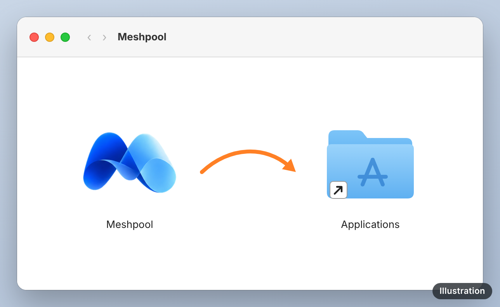
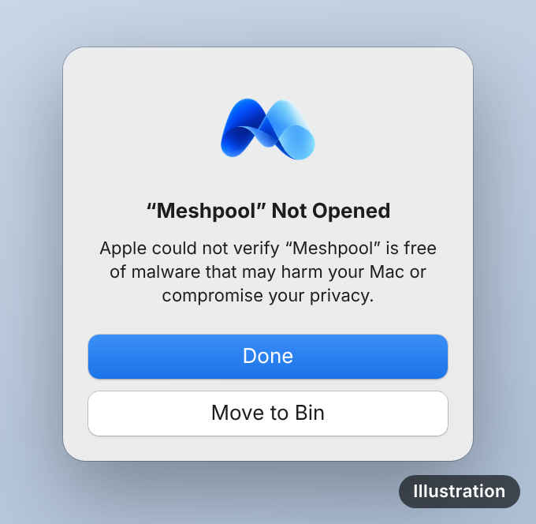
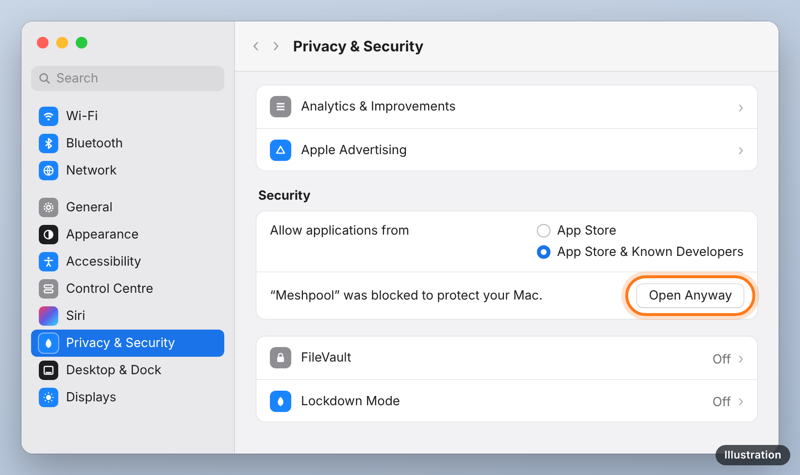
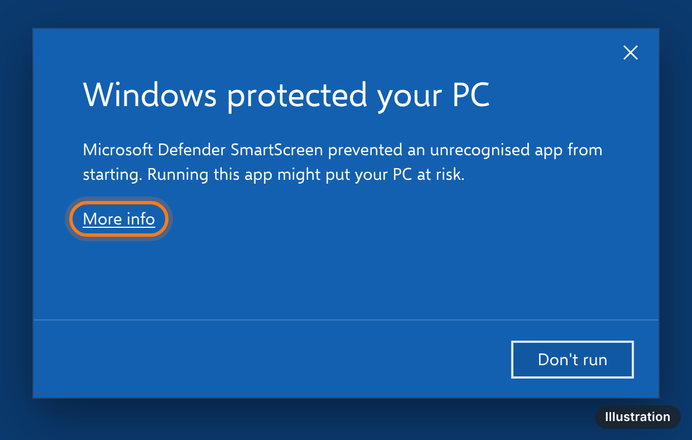
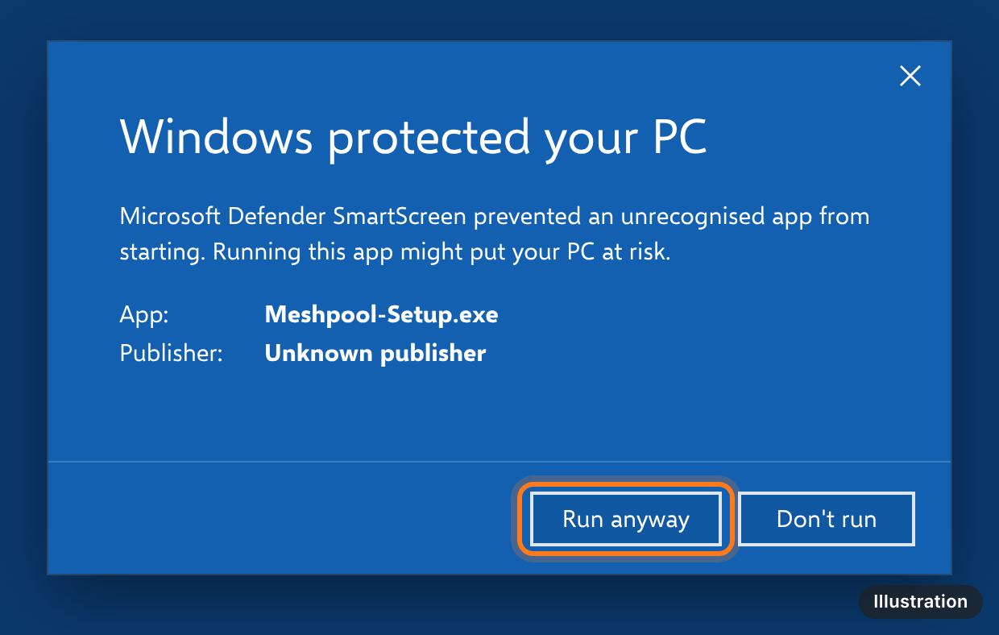
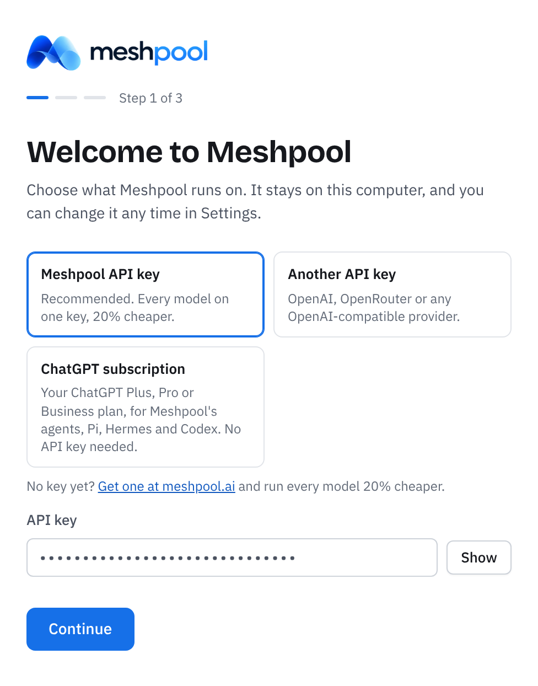

The first public beta of Meshpool: one desktop agent for code, documents, spreadsheets, decks and research.

- **Agents:** Meshpool Auto (picks per task: quality first, then cost and speed), Meshpool Code, Meshpool Work, Pi, Hermes, Codex and OpenCode, or add your own.
- **Runs on** your Meshpool API key, any OpenAI-compatible key, or your ChatGPT plan.
- **Office files** checked before they reach you: Word, Excel with live formulas, PowerPoint, PDF.
- **Decks** in a top strategy firm's style by default: the answer first in an executive summary, an agenda and section tracker, takeaway titles, a different exhibit on every page, Segoe UI and line icons. Add slides to your own deck in its look.

| Computer | Download |
|---|---|
| Mac with Apple silicon | Meshpool.dmg |
| Mac with Intel | Meshpool-Intel.dmg |
| Windows 10 or 11 | Meshpool-Setup.exe |

**Setup guide** ([full guide](https://github.com/hamzaaziada/meshpool-harness/blob/main/docs/SETUP.md))

*Mac, quickest:* open Terminal, paste this and press Return. It installs Meshpool and opens it with no security prompts:

```sh
curl -fsSL https://raw.githubusercontent.com/hamzaaziada/meshpool-harness/main/install.sh | bash -s -- --app
```

*Mac, from the download:*
1. Not sure which Mac you have? Apple menu → About This Mac: **Chip: Apple M…** takes Meshpool.dmg, **Intel** takes Meshpool-Intel.dmg.
2. Open the .dmg and drag **Meshpool** onto **Applications**.
   

3. Double-click Meshpool in Applications. macOS blocks it the first time: click **Done**.
   

4. Open **System Settings → Privacy & Security**, scroll to **Security**, click **Open Anyway** and enter your password. Meshpool opens, and opens normally from then on. (macOS 14 and earlier: right-click Meshpool in Applications, choose **Open**, then **Open**.)
   


*Windows:* run Meshpool-Setup.exe. If "Windows protected your PC" appears, click **More info**, then **Run anyway**.

 



*First launch:* paste your Meshpool API key ([get one at meshpool.ai](https://meshpool.ai)) or sign in with ChatGPT, then choose the folder Meshpool may work in. Updates: click the "is available" bar, or Settings → About → **Check for updates**, then **Update now**.

Apple silicon Macs need macOS 11 or later; Intel Macs macOS 10.15 Catalina or later (on 10.15, Pi, Codex, OpenCode and browser use need macOS 11). Meshpool is not yet signed by Apple or Microsoft, which is why your computer asks you to confirm it once. The pictures of the macOS and Windows prompts are illustrations; the wording on your computer may differ slightly.

This is a beta: when something breaks, click **Report this** next to the error, or the **Beta** badge.
